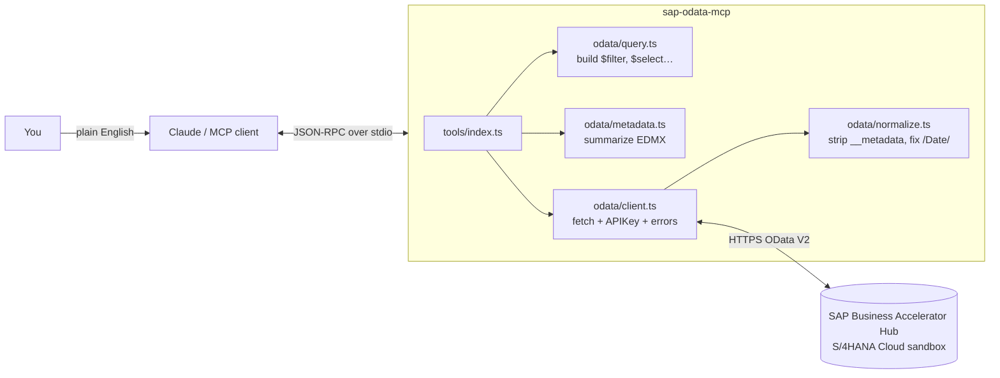

# sap-odata-mcp

**Ask your AI assistant about SAP data in plain English.**
An [MCP](https://modelcontextprotocol.io) server that lets Claude (or any MCP client) discover, understand, and query SAP S/4HANA OData services.

> "Show me the 5 largest sales orders from last quarter and who the sold-to parties are."

<!-- TODO: replace with a GIF of Claude Desktop using the tools -->


---

## Why this exists

SAP data sits behind OData services with names like `API_SALES_ORDER_SRV`, entity sets like `A_SalesOrder`, and fields like `SoldToParty`. Answering a simple business question usually means knowing the service, reading its `$metadata`, and writing a `$filter`.

This server gives an AI agent three tools so it can do that loop itself:

| Tool | What it does |
| --- | --- |
| `sap_list_services` | Shows the curated catalog of services, so the model knows where to look |
| `sap_describe_entity_set` | Reads `$metadata` and returns fields, types, labels, keys, and navigation properties |
| `sap_query` | Runs a read-only OData V2 query (`$filter`, `$select`, `$expand`, `$orderby`, paging) |

## Architecture



Design choices:
- **Read-only by design.** Every tool is annotated `readOnlyHint`, and there are no create, update, or delete operations.
- **Context-window aware.** Row caps, `$select` nudges, and response normalization keep the payloads small.
- **Errors are returned to the model, not thrown,** so the agent can read SAP's error (for example, a misspelled field) and retry.
- **Sandbox first.** It runs against SAP's public sandbox with a free personal API key, so no customer system is ever involved.

## Quick start

```bash
git clone https://github.com/<you>/sap-odata-mcp && cd sap-odata-mcp
npm install
cp .env.example .env        # add your SAP_API_KEY (see below)
npm test                    # see what's left to implement
npm run inspect             # poke at the tools in the MCP Inspector UI
```

**Get an API key:** sign in at [api.sap.com](https://api.sap.com), open any S/4HANA Cloud API (for example, *Sales Order (A2X)*), go to **Try Out**, and click **Show API Key**.

### Use it from Claude Desktop

`npm run build`, then add the following to `claude_desktop_config.json`:

```json
{
  "mcpServers": {
    "sap-odata": {
      "command": "node",
      "args": ["/absolute/path/to/sap-odata-mcp/dist/index.js"],
      "env": { "SAP_API_KEY": "your-key" }
    }
  }
}
```

### Use it from Claude Code

```bash
claude mcp add sap-odata -e SAP_API_KEY=your-key -- node /absolute/path/to/sap-odata-mcp/dist/index.js
```

## Project layout

```
src/
  index.ts            entry point: stdio transport
  config.ts           env validation with zod
  catalog.ts          curated services + descriptions (prompt engineering for tools)
  tools/index.ts      MCP tool definitions
  odata/
    client.ts         HTTP, auth header, SAP error parsing
    query.ts          ✍️ hand-written: OData query string builder
    normalize.ts      ✍️ hand-written: response cleanup
    metadata.ts       EDMX → compact schema summary
test/                 vitest specs (they define "done")
docs/ROADMAP.md       milestones + what each one teaches
```

## What I learned

<!-- Fill this in as you go. Recruiters read this section. -->
- OData V2 URI conventions and why `%2C` vs `,` matters to SAP Gateway
- …
- …

## Disclaimer

This is a personal learning project. It is not affiliated with or endorsed by SAP or my employer. It uses only SAP's public sandbox and mock data.

## License

MIT
